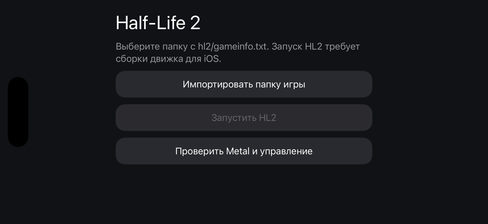
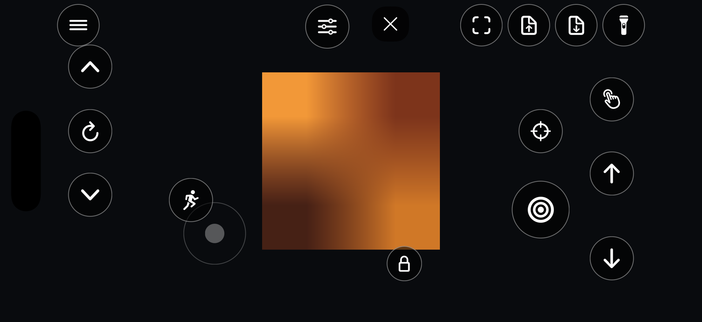

# Source Engine для iOS

Приложение для порта [nillerusr/source-engine](https://github.com/nillerusr/source-engine) на iPhone и iPad. Первая цель — Half-Life 2. Сейчас приложение импортирует пользовательскую папку игры, выводит тестовый материал через Metal и собирает экранный ввод. Для кнопки «Запустить HL2» требуется нативная сборка движка с адаптером из этого репозитория. Такой сборки пока нет.

## Скриншоты

Лаунчер на iPhone 17 в iOS Simulator.



Экранная раскладка из Android-версии Source в Metal-демо.



[Запуск Actions, в котором сняты скриншоты](https://github.com/skb8/srceng-ios/actions/runs/45042507697)

## Сборка

На macOS с Xcode и установленным iOS SDK:

```sh
brew install xcodegen glslang spirv-cross spirv-tools
xcodebuild -downloadComponent metalToolchain
scripts/build-ios.sh iphoneos
scripts/build-ios.sh iphonesimulator
```

[GitHub Actions](https://github.com/skb8/srceng-ios/actions/workflows/ios.yml) собирает оба варианта. Для iPhone или iPad скачайте артефакт `SourceIOS-unsigned-ipa` и извлеките `SourceIOS-unsigned.ipa`. IPA требует подписи перед установкой. В AltStore Classic откройте «My Apps», нажмите «+» и выберите IPA для подписи и установки.

Для установки из Xcode откройте сгенерированный `SourceIOS.xcodeproj` и выберите свою команду подписи. Для симулятора используйте архив `SourceIOS-iphonesimulator-unsigned`.

## Файлы игры и управление

В приложении нажмите «Импортировать папку игры» и выберите корневую папку установленной копии Half-Life 2. В ней должен находиться `hl2/gameinfo.txt`. Скопируйте папку целиком вместе с каталогами и VPK, на которые ссылается `gameinfo.txt`. Приложение хранит копию в своём контейнере. Игровые файлы в сборку не входят.

Кнопка «Проверить Metal и управление» открывает тестовый материал со стандартной раскладкой Android-порта. Коснитесь левой половины экрана и потяните палец, чтобы двигаться. Свайп справа управляет обзором, в том числе при удержании кнопки огня. Слева расположены переключение оружия, перезарядка и спринт. Справа находятся использование, огонь, альтернативный огонь, прыжок и приседание. Сверху доступны меню, приближение, фонарь, быстрое сохранение и загрузка. В Metal-демо огонь меняет цвет, а использование переключает карту освещения.

Позиции взяты из стандартного профиля Android-порта Source. На iOS кнопки используют системные значки и учитывают вырез экрана. Кнопка с ползунками включает перетаскивание, а круговая стрелка в центре сбрасывает позиции. Адаптер получает движение, относительный поворот, удержания и отдельные нажатия. При сворачивании приложения удержания сбрасываются. [Android-лаунчер](https://github.com/nillerusr/srceng-android/tree/7fb280dadf9c0199d1fa287844a02292ee9d281a) · [Исходная раскладка Source](https://github.com/nillerusr/source-engine/blob/9f9a2053b7a449ec8389c3eeaad693aa113396ec/game/client/touch.cpp#L312-L341)

## Подключение движка

[Workflow Source Engine arm64 libraries](https://github.com/skb8/srceng-ios/actions/workflows/engine.yml) собирает оригинальные `tier0`, `tier1`, `tier2`, `mathlib`, `vstdlib`, `appframework`, `filesystem_stdio` и `vpklib` для устройства и симулятора. Проверочный исполняемый файл подключает штатный `IFileSystem`, монтирует поисковые пути из `gameinfo.txt` и читает тестовый файл из VPK. Патч учитывает длину заголовка при чтении данных, встроенных в VPK v1 и v2. Ревизия движка закреплена в [`Engine/Upstream/revision`](Engine/Upstream/revision). Пока эти библиотеки собираются отдельно от лаунчера.

[Workflow Half-Life 2 native engine](https://github.com/skb8/srceng-ios/actions/workflows/hl2-engine.yml) использует штатный профиль выделенного сервера Source для iOS arm64. Он собирает `dedicated_launcher`, `libengine.dylib`, `libserver.dylib`, VPhysics и их зависимости для устройства и симулятора. Проверка на симуляторе запускает хост с минимальным `gameinfo.txt`, ждёт загрузки модуля HL2 и проверяет исполнение команд `echo` и `quit`. В проверке используются синтетические файлы. Клиент HL2 и игровой вывод Metal ещё нужны для запуска кампании из приложения.

Ветка [`ios` форка](https://github.com/nillerusr/source-engine/tree/79c3bc86bdc61b75d402514ee2f372753d1732bf) содержит изменения для Apple-платформ. В Waf эта ревизия использует профиль Darwin с AppKit, Carbon и OpenGL. В исходных путях рендера `materialsystem/shaderapidx9` отправляет D3D9-вызовы в `togl`, где байткод DX9 транслируется в GLSL. `launcher/launcher.cpp` и `engine/sys_dll2.cpp` владеют циклом запуска и кадров.

На стороне приложения [`SourceIOSAdapter.h`](Engine/SourceIOSAdapter.h) определяет вызовы запуска, кадра, приостановки и завершения. Статически скомпонованная сборка движка должна предоставить четыре функции из заголовка для соответствующего SDK и архитектуры. Адаптеру передаётся путь к игровым данным, имя `hl2` и `MTKView` после появления игрового экрана. Все вызовы выполняются на главном потоке. Во время кадра адаптер отвечает за получение и показ drawable. Приложение открывает сеанс с каталогом игры и возвращается в меню, когда адаптер завершает кадры. Если адаптер появится, его можно подключить флагами Xcode:

```sh
scripts/build-ios.sh iphoneos SOURCE_ENGINE_LINKED=1 SOURCE_ENGINE_LDFLAGS=/absolute/path/libSourceIOS.a
```

[`PreviewMaterials.hlsl`](Shaders/PreviewMaterials.hlsl) содержит тестовый вершинный шейдер, фрагментный шейдер с картой освещения и адаптацию базовой операции `UnlitGeneric` без преобразования sRGB. Скрипт преобразует HLSL в SPIR-V, проверяет его и генерирует MSL для iOS. Xcode компилирует MSL в `default.metallib` с версией iOS и SDK таргета приложения. В Metal тест использует индексированный меш, буфер глубины, базовую текстуру, карту освещения и константы материала. Для проверки генерации на Linux с установленными `glslangValidator`, `spirv-val` и `spirv-cross`:

```sh
scripts/compile-shaders.sh build/msl
```

## Игровые шейдеры

Отдельный [конвертер VCS](scripts/convert-legacy-shaders.py) извлекает скомпилированные варианты из файлов `.vcs` версии 6, сохраняет номера комбинаций и статические псевдонимы и генерирует MSL через [MojoShader](https://github.com/icculus/mojoshader). [Проверка в Actions](https://github.com/skb8/srceng-ios/actions/workflows/legacy-shaders.yml) компилирует тестовые вершинные и фрагментные варианты в iOS `.metallib`. Для конвертации своих VCS сначала получите MojoShader на ревизии из [`mojoshader-revision`](Engine/Upstream/LegacyShaders/mojoshader-revision), затем выполните:

```sh
scripts/build-legacy-shader-tool.sh /path/to/mojoshader build/legacy-shaders
scripts/convert-legacy-shaders.py build/legacy-shaders/d3d9-to-msl build/game-msl /path/to/shader.vcs
```

До запуска HL2 остаётся собрать клиент и сервер, подключить цикл кадров Source к UIKit и связать вызовы графического интерфейса Source с Metal. Для игровых шейдеров ещё нужно подключить загрузку вариантов и сопоставить форматы вершин, константы и текстуры с ресурсами Metal.
